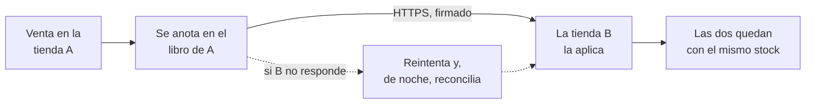

<p align="center">
  <picture>
    <source media="(prefers-color-scheme: dark)" srcset=".github/readme/logo-dark.png">
    
  </picture>
</p>

<h3 align="center">Stock Sync for WooCommerce</h3>

<p align="center">
  Sincroniza el stock entre dos tiendas WooCommerce que despachan del mismo depósito.<br>
  <b>Pool único, sin reparto:</b> lo que se vende en una se descuenta en la otra.
</p>

<p align="center">
  <a href="https://github.com/julianjuan77/woonderful-stock-sync-for-woocommerce/releases/latest"></a>
  
  
  
  
</p>

---

## Para qué sirve

Si tenés dos tiendas WooCommerce —por ejemplo, una mayorista y una minorista— que venden del
mismo depósito, probablemente repartís el stock entre las dos para no vender de más: 10
unidades se publican como 5 y 5. Woonderful Stock Sync termina con ese reparto: **las dos
tiendas muestran el stock real completo**, y una venta en cualquiera lo deja igual en las dos.

| Sin el plugin | Con el plugin |
| --- | --- |
| 10 unidades, publicadas como 5 en cada tienda | Las 10 en cada tienda |
| Una tienda se queda sin stock mientras la otra tiene | Las dos venden hasta la última unidad |
| Cada reposición se reparte y se carga dos veces | Se carga una vez, en la tienda maestra |

## Cómo funciona



- **Cualquier cambio de stock se propaga:** ventas, cancelaciones, reembolsos, ediciones en el
  admin, la API REST, WP-CLI o el importador CSV.
- **Productos simples y variaciones**, cada variación con su propio stock.
- **Una tienda maestra** vincula los productos —a mano o en lote, con sugerencias por SKU— y
  fija el stock de arranque de cada par. La otra muestra la misma pantalla en modo lectura.
- **Nada se pierde si la otra tienda se cae:** cada movimiento queda anotado, se reintenta y sale
  en orden. Una reconciliación nocturna completa lo que falte y compara las dos tiendas.
- **Igualar stock:** si las dos tiendas quedan con números distintos, el dueño elige cuál vale.
- **Avisos por email** agrupados, un registro de todo lo que pasó y el historial de cada producto.
- **Las tiendas hablan sólo entre ellas,** por HTTPS y con un secreto compartido. Sin servicios
  de terceros.

**Lo que no hace:** no sincroniza precios, títulos, imágenes ni categorías; no crea productos en
la otra tienda; no sincroniza pedidos ni clientes; y funciona con exactamente dos tiendas.

## Requisitos

| | Mínimo |
| --- | --- |
| WordPress | 6.5 |
| WooCommerce | 9.1 |
| PHP | 8.1 |
| Conexión entre las tiendas | HTTPS, cada una alcanzable desde la otra |

**Recomendado:** un cron real del servidor contra `wp-cron.php`, y PHP-FPM o LiteSpeed, para que
lo vendido salga al terminar cada pedido.

## Instalación

1. Bajá el zip de la [última versión](https://github.com/julianjuan77/woonderful-stock-sync-for-woocommerce/releases/latest).
2. Instalalo en **las dos** tiendas: *Plugins → Añadir nuevo → Subir plugin*.
3. En la tienda que va a ser la maestra, entrá a **Stock Sync** y seguí el asistente: revisa los
   requisitos y genera un código de emparejamiento.
4. En la otra tienda, abrí **Stock Sync** y pegá ese código.
5. En la maestra, cargá el stock real y vinculá los productos en **Stock Sync → Productos**.

Para actualizar, subí el zip nuevo de la misma forma y elegí **Reemplazar el actual con la
versión subida**: el emparejamiento y los vínculos se conservan.

Más detalle —el cron recomendado y las preguntas frecuentes— en el [`readme.txt`](readme.txt).

## Desarrollo

```bash
composer install     # dependencias de PHP y herramientas de tests
npm install
npm run build        # compila la interfaz (src/ → build/)
npm run lint:js
npm run test:unit
```

Los tests de PHP corren con PHPUnit sobre un WordPress con WooCommerce (`tests/`), y el lint con
PHPCS (WordPress Coding Standards) y PHPStan. Las decisiones de diseño están en
[`docs/DECISIONS.md`](docs/DECISIONS.md) y la arquitectura en
[`docs/ARCHITECTURE.md`](docs/ARCHITECTURE.md).

## Licencia

[GPL-2.0-or-later](license.txt). La interfaz usa Bricolage Grotesque, DM Sans y JetBrains Mono,
con licencia SIL Open Font License 1.1 (`assets/fonts/`).
